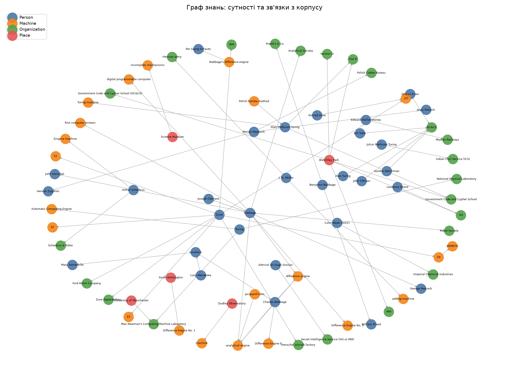

# Лабораторна робота №02. LLM-екстракція знань, векторний пошук та GraphRAG

## 1. Предметна область, джерела і запитання

Предметна область: ранні обчислювальні машини та криптографія Другої світової війни. Корпус складається з 10 англомовних статей Вікіпедії (ліцензія CC BY-SA 4.0): Charles Babbage, Difference engine, Analytical Engine, Ada Lovelace, Alan Turing, Enigma machine, Bletchley Park, Konrad Zuse, ENIAC, John von Neumann. Разом 65 242 слова. Список джерел з посиланнями: output/sources.json.

Прості запитання з однозначною відповіддю:
1. Хто спроєктував Analytical Engine?
2. Де було побудовано ENIAC?
3. Хто написав першу програму для Analytical Engine?

Запитання, що вимагають синтезу з кількох документів:
1. Хто є ключовими фігурами в історії ранніх обчислювальних машин і як вони пов'язані між собою?
2. Які теми повторюються найчастіше в цих документах?

## 2. Схема сутностей і видобуті факти

Схема має 4 типи сутностей (Person, Machine, Organization, Place) і 5 типів зв'язків (designed, worked_at, built_at, influenced, collaborated_with). Описана pydantic-моделлю у файлі schema.py. Кожен факт містить джерело (документ і чанк) і точну цитату з тексту.

Екстракція виконана Gemini (модель gemini-3-flash-preview) зі структурованим виводом у форматі JSON. Для економії безкоштовної квоти взято перший чанк кожного з 8 перших документів (разом 8 запитів). Отримано 71 факт (файл output/facts.json). Документи ENIAC і von Neumann у графі фактів не представлені.

Приклад факту: subject «Charles Babbage», relation «designed», object «Analytical Engine», evidence з тексту «The analytical engine was a proposed digital mechanical general-purpose computer designed by the English mathematician and computer pioneer Charles Babbage».

Ручна перевірка: випадкова вибірка з 20 фактів у output/manual_check.txt. Частка коректних фактів: 15 з 20, тобто 75% (команда manual_check.py --score). Кожна цитата знайдена в оригінальному тексті статті, тож вигаданих цитат немає, помилки стосуються інтерпретації.

Типові помилки моделі: (1) неправильний тип зв'язку, коли членство або експонат подано як роботу чи побудову (2 випадки); (2) обернений напрямок зв'язку (1 випадок: лабораторія розташована в Манчестері, а модель записала навпаки); (3) зв'язок, якого немає в тексті: переклад не означає вплив у заданому напрямку, а сусідня згадка не означає побудову (2 випадки). Пропусків у вибірці не виявлено, бо вибірка бралась з уже витягнутих фактів; повнота екстракції не перевірялась.

## 3. Векторний пошук і порівняння з keyword-пошуком

Тексти розбито на 99 чанків по 800 слів з перекриттям 100 слів. Розмір обрано так, щоб один чанк містив достатньо контексту для речення з фактом, а перекриття не дало розірвати факт на межі двох чанків. Ембединги отримано моделлю gemini-embedding-001 (task_type RETRIEVAL_DOCUMENT для чанків і RETRIEVAL_QUERY для запитів), пошук виконано через косинусну подібність у numpy. Keyword-пошук реалізовано через TF-IDF з sklearn.

Приклад, де семантичний пошук виграє. Запит «the first computer algorithm» не містить жодного точного збігу з текстом про Ади Лавлейс. TF-IDF знаходить фрагмент про фон Неймана, а векторний пошук повертає фрагмент з першою опублікованою програмою (Note G, обчислення чисел Бернуллі) на першому місці (схожість 0.745).

Приклад, де семантичний пошук програє. Запит «1837» це точне число. TF-IDF знаходить фрагмент, де воно згадується (doc03_c00), на першому місці. Векторний пошук повертає фрагменти про Беббіджа, які числа не містять, і фрагмент doc03_c00 у топ-5 не потрапляє. Вектори погано працюють з точними числами та кодами.

Повне порівняння для п'яти запитів: output/search_comparison.txt.

## 4. Граф знань, спільноти та GraphRAG

Граф побудовано в networkx: 80 вузлів і 67 зв'язків з фактів. Візуалізація: output/graph.png. Спільноти визначено алгоритмом Louvain (пакет python-louvain): знайдено 18 спільнот. Резюме спільнот з 3 і більше сутностями створено LLM. Відповіді записано у output/graphrag_answers.txt.



Глобальне запитання 1. GraphRAG відповідає структуровано: піонери (Беббідж, Лавлейс), розробники практичних машин (Цузе), криптографи (Тюрінг, Шербіус, польські математики), і посилається на номери спільнот. Vector-RAG (топ-5 чанків) охоплює переважно Беббіджа, Лавлейс і Менабреа з перших трьох статей, а тему криптографії та Тюрінга майже не згадує. Різниця в тому, що GraphRAG збирає узагальнення з усього корпусу, а vector-RAG бачить лише ті фрагменти, які найближчі до запитання.

Глобальне запитання 2 (найчастіші теми). GraphRAG виділяє чотири теми: розробка ранніх обчислювальних машин, криптографія Другої світової війни, наукова співпраця та вплив установ, і до кожної додає посилання на спільноти, з яких взято висновок. Vector-RAG називає насамперед «Енігму» і Блетчлі-Парк, а всі п'ять його чанків належать лише двом документам про криптографію (Enigma machine і Bletchley Park). Тобто vector-RAG правильно показує найгучнішу тему, але не бачить історії ранніх машин, бо топ-5 чанків для цього запитання не містять її. GraphRAG охоплює ширший корпус, але його відповідь залежить від того, які факти потрапили в граф (лише 8 документів).

Обмеження: граф побудовано лише з фактів 8 документів, тому деякі зв'язки (наприклад, ENIAC) у GraphRAG відсутні, а vector-RAG їх знає, бо бачить усі 99 чанків.

### Повні відповіді на глобальне питання

Нижче наведено повний текст обох відповідей з output/graphrag_answers.txt, без змін.

```text
ГЛОБАЛЬНІ ПИТАННЯ: GraphRAG проти vector-RAG

Питання: Хто є ключовими фігурами в історії ранніх обчислювальних машин і як вони пов'язані між собою?
GraphRAG (резюме спільнот -> фінальна відповідь):
Історія ранніх обчислювальних машин сформована кількома ключовими групами винахідників, математиків та криптографів, чия діяльність заклала фундамент сучасної комп’ютерної техніки.

### 1. Піонери програмованих обчислень (Беббідж та Лавлейс)
Основоположником концепції цифрового комп’ютера був **Чарльз Беббідж**, який розробив проєкти різницевих та аналітичної машин. Його робота базувалася на принципах роботи ткацького верстата Жакарда та велася у співпраці з Джоном Гершелем, Джорджем Пікоком і Джозефом Клементом (Спільнота 0). Важливою постаттю в цьому колі була **Ада Лавлейс**, яка співпрацювала з Мері Сомервілль і перебувала під інтелектуальним впливом Луїджі Менабреа, ставши ключовою фігурою в теоретичному обґрунтуванні обчислень (Спільнота 9).

### 2. Розробники перших практичних комп'ютерів (Цузе та Мюллер)
**Конрад Цузе** став творцем перших функціональних обчислювальних машин (Z2, Z3, Z4), що згодом вплинули на розвиток систем IBM та проєкту ERMETH (Спільнота 13). Паралельно з інженерними розробками в армії, **Й. Г. Мюллер** спроєктував одну з ранніх сумувальних машин (Спільнота 4).

### 3. Криптографія та розвиток логіки (Тюрінг, Шербіус та польські математики)
Важливий етап розвитку обчислювальної техніки пов’язаний із Другою світовою війною та криптографією:
*   **Артур Шербіус** створив шифрувальну машину «Енігма» (Спільнота 16).
*   Польські математики **Маріан Реєвський, Єжи Рожицький та Генрик Зигальський** розробили методи зламу «Енігми» (метод «бомби»), що безпосередньо вплинуло на подальші розробки (Спільнота 17).
*   **Алан Тюрінг**, працюючи в Блетчлі-Парку (підрозділ Hut 8 у межах GC&CS), розвинув ці ідеї, створивши теоретичну «машину Тюрінга» та згодом машину ACE (Спільноти 11, 12). У GC&CS він співпрацював з іншими видатними фахівцями, як-от **Ділвін Нокс, Гордон Велчман та Білл Татт** (Спільнота 8).

### 4. Професійні та інституційні зв'язки
Крім наукових зв’язків, важливу роль відігравали професійні структури. Наприклад, **Бенджамін Беббідж** був пов’язаний із фінансовими структурами (Praed's & Co), що демонструє діловий контекст того часу (Спільнота 3). Діяльність Тюрінга охоплювала не лише розвідку, а й провідні академічні установи, такі як Манчестерський університет (Лабораторія Макса Ньюмена) та Національна фізична лабораторія (Спільнота 12).

**Відповідь підкріплена даними з таких спільнот:**
*   **Концепції та ранні машини:** Спільноти 0, 9.
*   **Конрад Цузе та ранні пристрої:** Спільноти 4, 13.
*   **Криптографія та Алан Тюрінг:** Спільноти 8, 11, 12, 16, 17.
*   **Ділові зв'язки:** Спільнота 3.

vector-RAG (топ-5 чанків -> відповідь), чанки: doc01_c08, doc03_c02, doc01_c00, doc01_c07, doc03_c00:
Основними постатями в історії ранніх обчислювальних машин, згідно з наданим текстом, є:

*   **Чарльз Беббідж (Charles Babbage):** Англійський математик та винахідник, якого називають «батьком комп'ютера». Він розробив концепції Різницевої машини (для автоматичного обчислення поліноміальних функцій) та Аналітичної машини (першої концепції універсального програмованого комп’ютера).
*   **Джозеф Клемент (Joseph Clement):** Інженер, якого Беббідж залучив у 1823 році для реалізації дизайну Різницевої машини. У 1831 році вони розійшлися через суперечки щодо витрат.
*   **Ада Лавлейс (Ada Lovelace):** Співпрацювала з Беббіджем під час розробки Аналітичної машини. Вона розробила алгоритм для обчислення послідовності чисел Бернуллі за допомогою цієї машини, через що її часто називають першим програмістом. Вона також переклала англійською мовою статтю Луїджі Менабреа, додавши до неї власні розлогі коментарі.
*   **Луїджі Федеріко Менабреа (Luigi Federico Menabrea):** Італійський математик, який на основі лекцій Беббіджа в Турині (1840 рік) опублікував у 1842 році опис Аналітичної машини французькою мовою.
*   **Генрі Прево Беббідж (Henry Prevost Babbage):** Син Чарльза Беббіджа, який після смерті батька продовжував його роботу і побудував частину обчислювального вузла («млина») та друкарський апарат Аналітичної машини.
*   **Пер Георг та Едвард Шойц (Per Georg & Edvard Scheutz):** Шведські послідовники Беббіджа (батько та син), які, прочитавши про роботу Беббіджа, розробили власну версію різницевої машини.
*   **К. Дж. Джарвіс (C. G. Jarvis):** Кресляр, який раніше працював на Джозефа Клемента, а пізніше був найнятий Беббіджем для проєктування Аналітичної машини.

**Зв'язки між ними:**
Беббідж був центральною фігурою, яка об'єднувала інших. **Клемент** і **Джарвіс** забезпечували технічну та креслярську підтримку. **Менабреа** задокументував ідеї Беббіджа після його лекцій у Турині (куди Беббіджа запросив **Джованні Плана**), а **Ада Лавлейс** на прохання **Чарльза Вітстона** переклала ці записи, доповнивши їх власними алгоритмами. **Генрі Беббідж** успадкував і намагався практично реалізувати проєкти батька, тоді як шведські винахідники **Шойци** та **Мартін Віберг** розвивали ідеї різницевої машини незалежно, але під впливом публікацій про роботу Беббіджа.

Питання: Які теми повторюються найчастіше в цих документах?
GraphRAG (резюме спільнот -> фінальна відповідь):
Аналіз наданих звітів дозволяє виділити кілька ключових тем, які повторюються найчастіше:

### 1. Розробка ранніх обчислювальних та цифрових машин
Це найбільш наскрізна тема. Документи детально описують еволюцію обчислювальної техніки:
*   **Чарльз Беббідж** та його концепції цифрового комп'ютера, принтерів і різницевих машин (Спільнота 0).
*   **Й. Г. Мюллер** та його проєкт сумувальної машини (Спільнота 4).
*   **Конрад Цузе**, який створив серію машин Z (Z2, Z3, Z4) та спеціалізовані пристрої (Спільнота 13).
*   **Алан Тюрінг** із його теоретичною «машиною Тюрінга» та розробкою ACE (Automatic Computing Engine) (Спільноти 11, 12).
*   **Підтримка:** Спільноти 0, 4, 11, 12, 13.

### 2. Криптографія та розшифрування (особливо в контексті Другої світової війни)
Значна частина даних присвячена створенню та зламу шифрів:
*   **Створення «Енігми»** Артуром Шербіусом (Спільнота 16).
*   **Діяльність польських криптографів** (Маріан Реєвський та колеги), які працювали над розгадуванням кодів у Польському бюро шифрів (Спільнота 17).
*   **Британська криптографія в Блетчлі-Парку**, де Алан Тюрінг та його колеги працювали в межах Школи урядових кодів та шифрів (GC&CS) над протидією німецьким шифрам (Спільноти 8, 11).
*   **Підтримка:** Спільноти 8, 11, 16, 17.

### 3. Наукова співпраця та професійні мережі
Документи акцентують увагу на тому, що винаходи були результатом колективної праці або інтелектуального впливу:
*   Співпраця Беббіджа з Гершелем та іншими вченими (Спільнота 0).
*   Інтелектуальна мережа навколо Ади Лавлейс, Мері Сомервілль та Луїджі Менабреа (Спільнота 9).
*   Командна робота польських математиків (Спільнота 17) та групи криптографів у GC&CS (Спільнота 8).
*   Робочі зв'язки Бенджаміна Беббіджа у фінансових структурах (Спільнота 3).
*   **Підтримка:** Спільноти 0, 3, 8, 9, 17.

### 4. Вплив організацій та інституцій на розвиток технологій
Важливу роль відіграють установи, де проводилися дослідження:
*   Державні та військові структури: GC&CS (Блетчлі-Парк), Польське бюро шифрів, гессенська армія (Спільноти 4, 8, 11, 17).
*   Наукові та освітні заклади: Національна фізична лабораторія, Манчестерський університет (Спільнота 12).
*   Приватні компанії: IBM, Ford, Henschel (Спільнота 13).
*   **Підтримка:** Спільноти 4, 8, 11, 12, 13, 17.

**Висновок:** Найчастіше повторюються теми **історії обчислювальної техніки**, **військової та державної криптографії**, а також **міжособистісної наукової взаємодії** у межах спеціалізованих організацій.

vector-RAG (топ-5 чанків -> відповідь), чанки: doc01_c10, doc06_c09, doc07_c03, doc05_c04, doc06_c08:
На основі наданих документів найчастіше повторюються такі теми:

1.  **Машина «Енігма» (Enigma machine):** детально описуються технічні аспекти її роботи, процес шифрування та дешифрування повідомлень, різні моделі (комерційні та військові), а також процедури, які використовували різні роди військ Німеччини (Heer, Luftwaffe, Kriegsmarine) [doc06_c09, doc06_c08, doc05_c04, doc07_c03].
2.  **Блетчлі-Парк (Bletchley Park):** робота британського центру дешифрування під час Другої світової війни, його секретні назви (наприклад, «Station X»), структура підрозділів (система «хатин» — Huts 1–9) та роль у зборі розвідувальних даних [doc07_c03, doc05_c04].
3.  **Криптоаналіз та розвідка:** злам кодів «Енігми» (включаючи внесок польського Бюро шифрів), розробка методів боротьби з шифрувальними машинами (Lorenz SZ 40/42), значення розвідданих «Ultra» та їхній вплив на скорочення тривалості війни [doc05_c04, doc06_c08, doc07_c03].
4.  **Видатні вчені та їхній внесок:**
    *   **Алан Тюрінг:** його робота в Блетчлі-Парку, математичні праці з криптографії, особисті ексцентричні звички та спортивні досягнення [doc05_c04].
    *   **Чарльз Беббідж:** його наукові публікації, розробка Аналітичної машини та відображення його життя в масовій культурі [doc01_c10].
5.  **Безпека та секретність:** заходи щодо збереження таємниці в Блетчлі-Парку, витоки інформації, використання кодових назв та дія Акта про державну таємницю [doc07_c03, doc05_c04].
```

## 5. Реальна помилка та її виправлення

Під час виконання було три реальні проблеми.

Перша: ліміт безкоштовної квоти Gemini. Прогін дійшов до приблизно 17 чанка і зупинився з помилкою 429 RESOURCE_EXHAUSTED, а результати не були збережені. Виправлення: екстракція зберігає прогрес після кожного чанка (output/facts_partial.json), обмежено кількість чанків для екстракції (8 документів), а після досягнення добового ліміту програма зупиняється з повідомленням, а не чекає годинами. Відповіді моделі кешуються в output/llm_cache.json, тому повторний запуск не витрачає квоту на вже отримане.

Друга: ліміт ембедингів на хвилину (30 000 токенів). Пакет з 50 чанків перевищував ліміт. Виправлення: пакети по 5 текстів з паузою 15 секунд.

Третя: резюме спільнот з 2 сутностями давали марні запити. Виправлення: резюмуються лише спільноти з 3 і більше сутностями.

## 6. Висновки

Пайплайн повністю реалізує завдання: від корпусу і екстракції за схемою через векторний і keyword-пошук до графа, спільнот і двох способів відповіді на глобальне запитання. Головний компроміс — обсяг екстракції: через безкоштовну квоту граф побудовано лише на 8 документах, а не на всьому корпусі. Векторний пошук сильний на перефразуваннях і слабкий на точних числах, тому на практиці їх варто поєднувати (гібридний пошук). GraphRAG дає узагальнення, яких немає в жодному окремому чанку, але залежить від якості екстракції та кількості запитів до моделі.

## 7. Посилання на код

Код лежить у папці лаб2 на комп'ютері: config.py, corpus.py, chunking.py, schema.py, llm.py, extract.py, manual_check.py, search.py, graph_rag.py, main.py, run_lab.py (тимчасовий запуск із ключем, після лаби його треба видалити). Публічного репозиторію немає.

## 8. Як запускати

1. Створити файл .env у папці лаб2 і вписати в нього GEMINI_API_KEY=ваш_ключ (шаблон у env.example). Ключ беремо на aistudio.google.com.
2. Встановити залежності: pip install -r requirements.txt
3. Запустити: python main.py. Повторний запуск використовує вже збережені файли і кеш. Щоб перезібрати факти і ембединги, додати --force (витрачає ліміт API).
4. Результати з'являться в папці output: facts.json, manual_check.txt, search_comparison.txt, graph.png, graphrag_answers.txt.
5. Перевірити ручну вибірку: відкрити output/manual_check.txt, позначити вердикти і виконати python manual_check.py --score.
6. Якщо досягнуто добового ліміту, запустити python main.py наступного дня. Готові кроки пропускаються.
